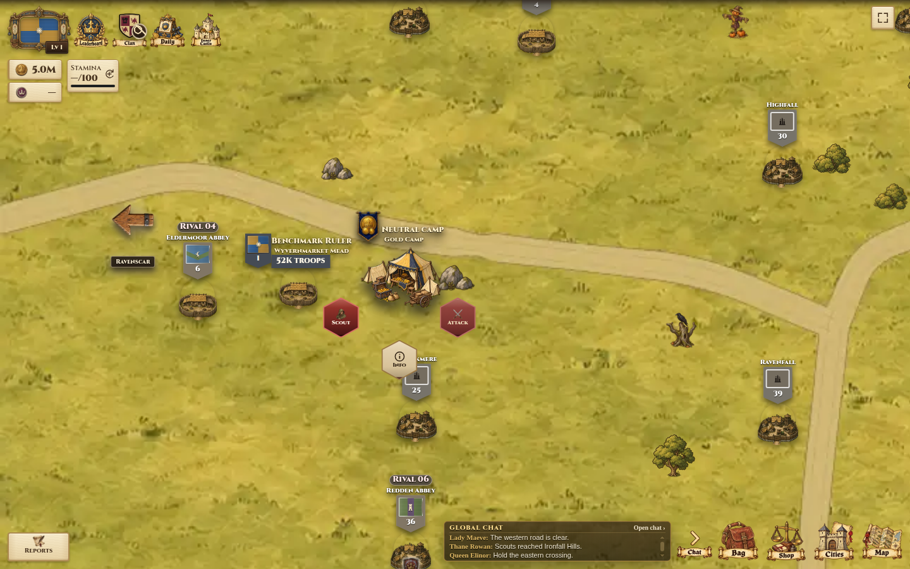
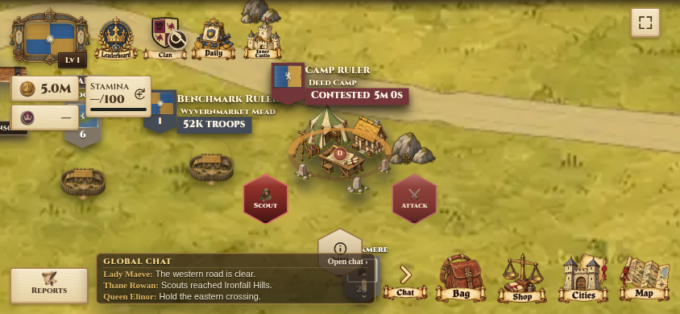
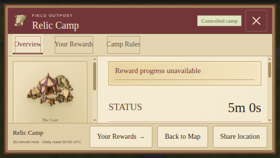

# Clean map ground and camp blending

Confirmed October 20, 2026 for the active `core-expansion-v1` presentation. The
production realm was checked as `main-realm-2026-10` / `realm-2026-10` before work.

## Artwork

The owner's `game theme.webp` supplies the medieval atlas direction. Built-in
imagegen produced `ground.png` and edited the four existing camp paintings. Exact
prompts are in `prompts.json` and `refinement-prompt.txt`. The refinement reduces
the meadow's texture contrast so units, cities and roads remain easy to read.

All 81 prepared backgrounds contain only meadow and connected ochre roads. Trees,
rocks and other existing scenery retain their independent layers and positions;
seasonal scenery is unchanged. Atlas thumbnails combine the new background with
those same separate scenery assets. Their interactive landmarks remain separate.

Road rendering uses the existing sampled centerlines and variable widths from
`tools/map-art/clearance.json`, including the existing landmark approaches. A
single ribbon mask removes outline seams at junctions. The owner's subsequent
[dirt-road refinement](../blended-dirt-roads/README.md) replaces the initial flat
fill and inside edges with painted soil and irregular blended shoulders.
The four cardinal exits continue to meet at the same neighboring-map positions.

Camp source files and the content-addressed delivery manifest are in
`docs/visual-qa/camp-artwork-v3/`. Transparent gaps replace the large floor islands;
small olive contact patches remain immediately under equipment. Map, atlas, camp
windows, held-camp lists and order previews use the same 384px WebP files. Existing
canvas sizes, anchors, type colors, flags and gameplay remain unchanged. The four
v2 delivery sprites are retired; historical source paintings remain as provenance.

## Reproduction and safeguards

With Sharp available as an authoring dependency, run:

```sh
CROWNLANDS_SHARP_MODULE=/absolute/path/to/sharp node tools/build-clean-map-ground.js
```

Use `--map=<prepared-region-id>` for a single-map preview; that mode deliberately
does not update receipts. A full build updates background hashes, thumbnails and
the client asset version. Delivery uses full-resolution WebP at quality 64, keeping
road edges clear within the existing total download budget. The build does not write server catalogs, road samples,
city coordinates, NPC data, realm state or release contracts. `preserved-inputs.json`
records their pre-change hashes and the 81 original road geometry hashes.

The client projection translates both canonical server camp references and the
previous client references into v3 assets. Server-descriptor refresh and lazy map
loads therefore keep using the current paintings without a backend deployment.

## Validation and publication

Targeted checks cover road connectivity and entrances, preserved gameplay inputs,
NPC road regeneration, city/scenery clearance, catalog/receipt consistency,
retired references and production asset budgets. Browser checks decode all 81
backgrounds and sample the actual road pixels. They also verify transparent camp
floors, atlas and UI references, server refreshes, neutral/held states, selection,
countdowns and zoom at desktop and landscape-mobile sizes.

Publication status must be verified against the live local-deployment receipt;
source changes or a merged PR alone do not establish that these assets are live.

Local review passed for 81 backgrounds, 264 connected road segments and 14,303
decoded road-center samples with zero missing road pixels. All 3,720 city
identities/positions, 2,967 separate scenery placements and 21 landmark anchors
remain unchanged. Camp/browser checks passed at 1440 × 900, 844 × 390 and
568 × 320 with no browser exceptions. The production artifact and existing
preload, cache and total-download budgets passed (82.75 MiB packaged client;
backgrounds approximately 119–123 KiB each). Screenshots below were reviewed
using isolated fixtures, without changing production player data.




